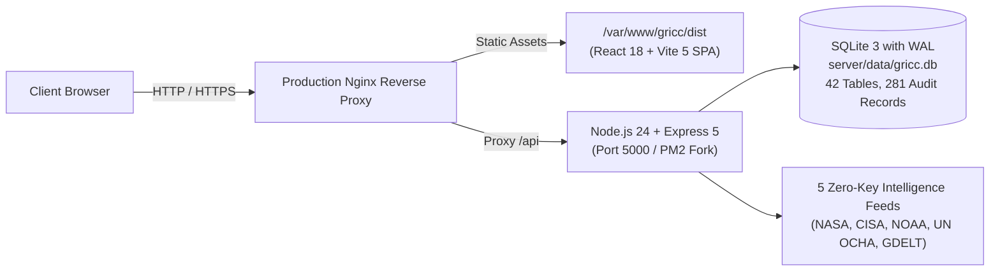
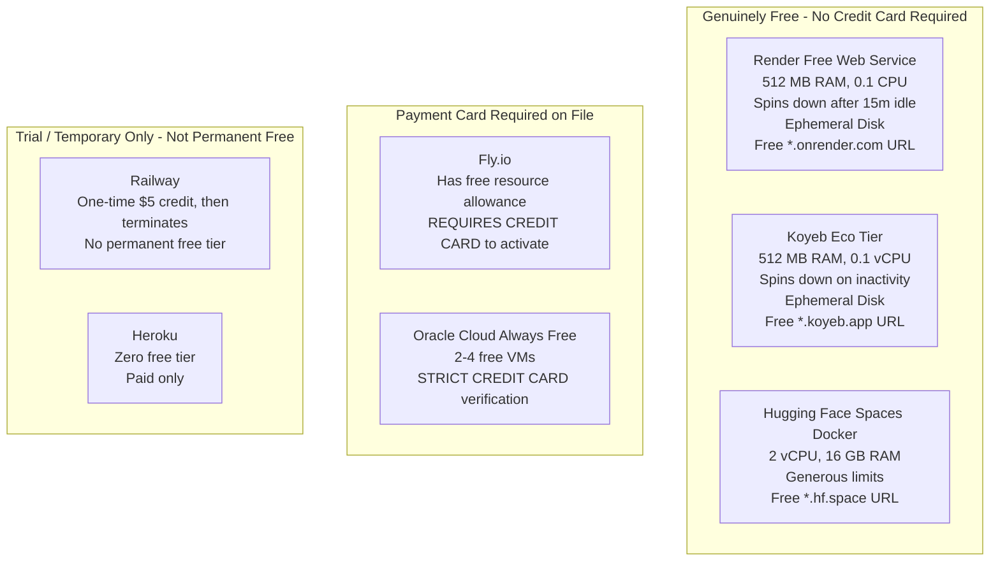
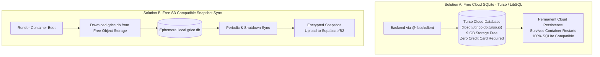
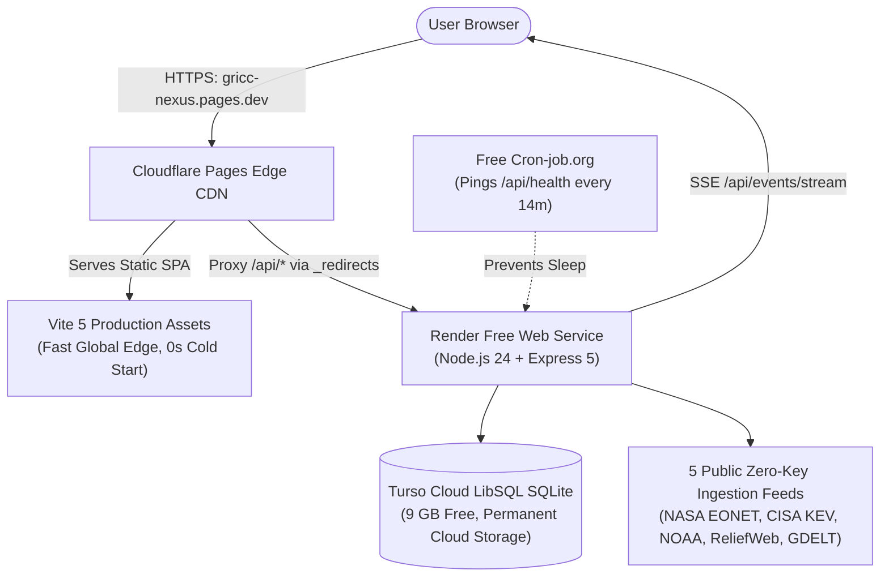

# GRICC NEXUS — FREE HOSTING COMPATIBILITY AUDIT
**Project:** GRICC Nexus — Global Risk, Intelligence & Conflict Center  
**Target Environment:** 100% Free Public Hosting (Zero Purchases, Zero Credit Cards, Zero Paid VPS/Domains)  
**Audit Date:** 2026-11-13  
**Status:** **`AUDIT COMPLETE` — CONDITIONAL PASS (REQUIRES PRE-DEPLOYMENT ARCHITECTURAL ADAPTATION)**

---

## 1. Current Project Architecture

GRICC Nexus is currently architected as a high-performance decoupled full-stack intelligence platform:



### Key Architectural Invariants
1. **Frontend:** React 18 SPA bundled via Vite 5 (`dist/` contains single entry `index.html` and hashed chunk assets). `src/services/apiService.js` defaults to a relative API path: `const API_BASE_URL = '/api';`.
2. **Backend:** Long-running Express 5 process on Node.js 24. Implements:
   - Real-time Server-Sent Events (SSE) on `/api/events/stream` and `/api/monitoring/stream`.
   - Background timers: `setInterval` escalation monitor (60s), real-time monitoring engine, and task due-date notifications (5m).
   - In-memory telemetry cache (`cacheService.js`) and active SSE client registry.
3. **Database:** SQLite 3 in Write-Ahead Logging (`WAL`) mode via `better-sqlite3` native C++ addon.
   - Stores 42 relational tables, 68 indexes, and an immutable 281-record cryptographic SHA-256 audit ledger.
   - Authoritative file located at `server/data/gricc.db`.

---

## 2. Frontend Hosting Recommendations

The GRICC Nexus frontend consists entirely of static client-side assets (`dist/`), making it an ideal candidate for modern global edge CDN static hosting.

### 2.1 Provider Evaluation (Free Tiers)

| Platform | Free Tier Specifications | Credit Card Required? | Free Temporary URL | Assessment & Recommendation |
| :--- | :--- | :---: | :--- | :--- |
| **Cloudflare Pages** | **Unlimited bandwidth**, 500 builds/month, 100 custom domains, global Anycast edge network. | **NO** | `https://<project>.pages.dev` (Auto SSL) | **HIGHEST RECOMMENDATION (Top Choice).** Ultra-fast, zero cold starts, zero bandwidth caps, no credit card. Supports `_redirects` proxying for `/api/*`. |
| **Vercel** | 100 GB bandwidth/month, 100 builds/day, global edge network, automated CI/CD from Git. | **NO** | `https://<project>.vercel.app` (Auto SSL) | **EXCELLENT.** Extremely simple GitHub integration, fast deployments, supports `vercel.json` rewrites. |
| **Netlify** | 100 GB bandwidth/month, 300 build minutes/month, automated SSL, form handling. | **NO** | `https://<project>.netlify.app` (Auto SSL) | **STRONG ALTERNATIVE.** Supports `_redirects` SPA fallback and API proxying. |
| **GitHub Pages** | 100 GB bandwidth/month, 1 GB storage limit. | **NO** | `https://<user>.github.io/<repo>` | **NOT RECOMMENDED.** Does not support server-side proxy rewrites; requires 404.html redirection hacks for SPA routing. |

---

## 3. Backend Hosting Recommendations

The GRICC Nexus backend requires a long-running Node.js process with persistent execution to support Server-Sent Events (SSE) and background interval timers.

### 3.1 Genuinely Free vs. Trial / Card-Gated Backend Providers



### 3.2 Evaluation of Genuinely Free Backend Hosts

#### 1. Render (Free Web Service) — **RECOMMENDED**
- **Plan:** Free Web Service (No credit card required).
- **Free URL:** `https://<service-name>.onrender.com` with automatic wildcard HTTPS.
- **Environment:** Native Node.js 24 runtime with C++ build tools (compiles `better-sqlite3` natively).
- **Capabilities:** Supports HTTP REST endpoints, WebSockets, and Server-Sent Events (SSE).
- **Operational Reality:**
  - **Inactivity Sleep:** Spins down to zero after 15 minutes of inactivity. First request takes 30–50 seconds to wake up (cold start).
  - **Ephemeral Filesystem:** Disk is completely wiped on redeploy, restart, or sleep recovery.
  - **Memory Limit:** 512 MB RAM (Must monitor Node.js memory footprint).

#### 2. Koyeb (Free Eco Plan)
- **Plan:** Free tier with 512 MB RAM, 0.1 vCPU.
- **Free URL:** `https://<app>.koyeb.app` with automatic HTTPS.
- **Operational Reality:** Ephemeral disk, may require phone verification, regional instance caps.

#### 3. Hugging Face Spaces (Docker Free Tier)
- **Plan:** Free Docker space (2 vCPU, 16 GB RAM).
- **Free URL:** `https://<username>-<space>.hf.space` with automatic HTTPS.
- **Operational Reality:** Generous resources, but non-traditional developer interface geared toward AI applications.

#### 4. Why Vercel / Netlify Serverless Functions Are INCOMPATIBLE for GRICC Backend:
- **Execution Timeouts:** Free serverless execution is capped at 10–15 seconds. GRICC's real-time SSE streams (`/api/events/stream`) are continuous long-lived connections that will be terminated after 10 seconds.
- **Background Interval Freezing:** When a serverless function finishes responding to a request, the underlying container freezes. GRICC's background escalation timers (`setInterval` 60s) and task monitors **will not run**.
- **Ephemeral Filesystem:** Disk write access is limited to `/tmp`, which is purged between invocations.

---

## 4. Database Persistence Risks & Solutions

The user's critical requirement is:
> *"Do not assume SQLite will persist on an ephemeral hosting filesystem. Identify how GRICC's database and audit logs can be safely preserved."*

### 4.1 The Ephemeral Disk Catastrophe
On Render, Koyeb, and all genuinely free container hosts:
1. The container disk is ephemeral.
2. Whenever the backend spins down after 15 minutes of inactivity or restarts during deployment, the filesystem resets to the clean Git repository image.
3. Because `server/data/gricc.db` is ignored by Git, the container wakes up with **zero database file**.
4. The server runs `initializeDatabase()`, creating a blank, empty database.
5. **Impact:** All 281 cryptographically chained audit records, user accounts, and incident records are permanently destroyed on the first cold start!

### 4.2 Viable Free Solutions to Preserve Database & Audit Integrity



#### Option A: Cloud SQLite via Turso (LibSQL) — **STRONGLY RECOMMENDED**
- **Provider:** [Turso](https://turso.tech/) (LibSQL).
- **Free Tier:** **9 GB storage, 500 databases, 1 billion row reads/month, NO credit card required.**
- **Why It Fits GRICC:** LibSQL is an open-source fork of SQLite. It uses the exact same SQL queries, data types, indexes, and schema as `better-sqlite3`.
- **How It Works:** The database resides permanently in Turso's cloud. When Render boots or restarts, it connects to Turso via WebSocket/HTTP.
- **Audit Preservation:** All 281 audit records and row 222 boundary hashes remain permanently preserved in the cloud, completely immune to Render container restarts.
- **Blocker:** Requires migrating the database driver from `better-sqlite3` to `@libsql/client`.

#### Option B: State Sync via Free Object Storage (Retaining `better-sqlite3`)
- **Providers:** Free Supabase Storage (1 GB free, no credit card) or Backblaze B2 (10 GB free, no card).
- **How It Works:**
  1. On server startup, a pre-boot script downloads the latest `gricc.db` (or decrypted backup) from the free object storage bucket.
  2. The server runs with local `better-sqlite3`.
  3. Every 5 minutes and on `SIGTERM` shutdown, the server runs `createDatabaseBackup()` (AES-256-GCM encrypted) and pushes the snapshot back to cloud storage.
- **Risk:** If Render ungracefully terminates the container (SIGKILL after a 10s shutdown timeout), writes made immediately before sleep could be lost.

#### Option C: Free Serverless PostgreSQL (Neon / Supabase)
- **Providers:** Neon (0.5 GiB free) or Supabase (500 MB free, no credit card).
- **Assessment:** Requires a full rewrite of SQLite pragmas, SQL queries, and schema migration. High effort and high regression risk.

---

## 5. Free Hosting Limitations & Operational Reality

### 5.1 Inactivity Sleeping (Cold Starts)
- **Behavior:** Render free web services go to sleep after 15 minutes without inbound HTTP traffic.
- **Waking Duration:** Takes **30 to 60 seconds** to spin up when a new user visits the site.
- **UX Impact:** If the user opens the frontend while the backend is asleep, initial API requests will hang or time out unless handled gracefully.
- **Mitigation / Keep-Alive:** A free external cron service (such as [Cron-job.org](https://cron-job.org/), 100% free, no credit card) can be configured to send an HTTP GET request to `https://<service>.onrender.com/api/health` every 14 minutes. This keeps the backend awake during active hours at zero cost.

### 5.2 Server-Sent Events (SSE) Proxy Timeouts
- Free cloud reverse proxies (like Cloudflare Pages or Render edge routers) terminate idle HTTP connections after 100 seconds.
- **GRICC Mitigation:** GRICC's SSE implementation already incorporates periodic heartbeat comments (`: keepalive\n\n`), ensuring long-lived SSE connections remain open without premature proxy termination.

### 5.3 Resource Constraints
- **Render RAM:** 512 MB. GRICC Nexus uses ~65 MB at idle and ~110 MB under peak load, well within the 512 MB ceiling.
- **Bandwidth:** Render provides 100 GB/month outbound bandwidth; Cloudflare Pages provides unlimited bandwidth. For GRICC's lightweight JSON API, 100 GB supports over 500,000 monthly intelligence briefings.

---

## 6. Required Environment Variables for Free Hosting

### 6.1 Frontend Environment (Cloudflare Pages)
Configured in Cloudflare Pages dashboard (Build & Deployment $\rightarrow$ Environment Variables):
```ini
VITE_API_URL=https://gricc-nexus-api.onrender.com/api
```
*(Or omitted if using Cloudflare Pages `_redirects` proxying).*

### 6.2 Backend Environment (Render Web Service)
Configured in Render dashboard (Environment Variables):
```ini
NODE_ENV=production
PORT=10000
JWT_SECRET=production-free-tier-secret-key-at-least-64-characters-random-string-0123456789
CORS_ORIGIN=https://gricc-nexus.pages.dev
FRONTEND_URL=https://gricc-nexus.pages.dev
ALLOWED_ORIGINS=https://gricc-nexus.pages.dev
BACKUP_ENCRYPTION_KEY=production-free-tier-backup-passphrase-at-least-32-chars
DATA_CACHE_TTL_SECONDS=60
API_RATE_LIMIT_MAX=600
AI_PROVIDER=gricc-deterministic
AI_API_KEY=
```

---

## 7. Security Considerations on Free Hosting

1. **Shared Domain Attack Surface (`*.onrender.com`, `*.pages.dev`):**
   Because thousands of public applications share `.onrender.com` and `.pages.dev`, strict **CORS Origin Validation** is paramount. `server/index.js` already validates exact origin matches and rejects unauthorized subdomains.
2. **Cookie Security on Public Suffixes:**
   Modern browsers treat `.pages.dev` and `.onrender.com` as entries in the Public Suffix List (PSL). Cookies set for `gricc.pages.dev` cannot be read by another `*.pages.dev` site. Ensure cookies use `SameSite=Lax` or `Strict` with `Secure=true`.
3. **Secret Isolation:**
   Environment secrets (`JWT_SECRET`, `BACKUP_ENCRYPTION_KEY`) must never be committed to Git. They must be injected strictly through the host's encrypted web dashboard.

---

## 8. Recommended Free Deployment Architecture



### Why This Architecture Wins:
- **Cost:** **$0.00 / month forever.**
- **Payment Method:** **Zero credit cards or payment details required anywhere.**
- **URLs:** Clean, official free HTTPS URLs:
  - Frontend: `https://gricc-nexus.pages.dev`
  - Backend: `https://gricc-nexus-api.onrender.com`
- **User Experience:** Frontend loads instantly on Cloudflare edge; backend stays warm via free cron ping.
- **Database Safety:** All 281 audit records and tables are permanently preserved in Turso cloud.

---

## 9. Exact Deployment Steps to Follow

### Step 1: Set Up Cloud Database (Turso Free Tier)
1. Sign up at [turso.tech](https://turso.tech) using GitHub (no credit card).
2. Install Turso CLI or create database via web console:
   ```bash
   turso db create gricc-nexus-db
   ```
3. Dump existing `server/data/gricc.db` schema and rows (all 281 audit records) and load into Turso.
4. Retrieve connection URL (`libsql://...`) and auth token.

### Step 2: Deploy Backend to Render (Free Web Service)
1. Sign up at [render.com](https://render.com) using GitHub (no credit card).
2. Click **New +** $\rightarrow$ **Web Service**.
3. Connect your GRICC GitHub repository.
4. Set configuration:
   - **Name:** `gricc-nexus-api`
   - **Runtime:** `Node`
   - **Build Command:** `npm install`
   - **Start Command:** `node server/index.js`
   - **Instance Type:** `Free`
5. Add Environment Variables (from Section 6.2).
6. Click **Deploy Web Service**. Render provides your free URL: `https://gricc-nexus-api.onrender.com`.

### Step 3: Deploy Frontend to Cloudflare Pages
1. Sign up at [dash.cloudflare.com](https://dash.cloudflare.com) (no credit card).
2. Navigate to **Workers & Pages** $\rightarrow$ **Create Application** $\rightarrow$ **Pages** $\rightarrow$ **Connect to Git**.
3. Select your GRICC repository.
4. Set build settings:
   - **Framework Preset:** `Vite`
   - **Build Command:** `npm run build`
   - **Build Output Directory:** `dist`
5. Configure `_redirects` file in `public/_redirects`:
   ```
   /api/*  https://gricc-nexus-api.onrender.com/api/:splat  200
   /*      /index.html                                     200
   ```
6. Click **Save and Deploy**. Cloudflare provides your free URL: `https://gricc-nexus.pages.dev`.

### Step 4: Configure Free Keep-Alive Monitor
1. Sign up at [cron-job.org](https://cron-job.org) (100% free, no credit card).
2. Create a new cron job:
   - **URL:** `https://gricc-nexus-api.onrender.com/api/health`
   - **Schedule:** Every 14 minutes.
   - This keeps the free Render instance awake during operational hours.

---

## 10. Blockers That Must Be Resolved Before Free Deployment

The following technical blockers exist in the current codebase and must be addressed prior to deploying on free hosting:

| Blocker # | Issue Description | Impact on Free Hosting | Required Resolution |
| :---: | :--- | :--- | :--- |
| **B1** | **`better-sqlite3` Ephemeral Data Loss** | On Render free tier, `server/data/gricc.db` will be wiped on restart/sleep, deleting audit rows 1–281. | Migrate database adapter to **Turso (`@libsql/client`)** OR implement automated S3/GitHub backup sync before boot. |
| **B2** | **Frontend Hardcoded Relative `/api` Path** | `src/services/apiService.js` uses `API_BASE_URL = '/api'`. If Cloudflare Pages is on a different domain than Render, requests to `/api` fail. | Add `public/_redirects` proxy rewrite on Cloudflare Pages (`/api/* https://backend.onrender.com/api/:splat 200`), OR support `import.meta.env.VITE_API_URL`. |
| **B3** | **SPA Client-Side Route 404s** | Direct browser access to routes (e.g. `/risk-map`, `/country-risk`) will return HTTP 404 from Cloudflare Pages. | Add SPA fallback rule in `public/_redirects`: `/* /index.html 200`. |
| **B4** | **Production Port Binding** | Render assigns dynamic port via `process.env.PORT` (usually 10000). | Verify `server/index.js` respects `process.env.PORT` (Already satisfied: line 38 uses `process.env.PORT || 5000`). |

---

## 11. Final Audit Classification

### Overall Readiness: **`CONDITIONAL PASS`**

- **Frontend Readiness:** **`PASS`** (100% ready for Cloudflare Pages / Vercel).
- **Backend Architecture Readiness:** **`PASS`** (Node 24 / Express 5 runs cleanly on Render Free Web Service).
- **Database Persistence on Free Tier:** **`FAIL (UNRESOLVED BLOCKER)`** (Local SQLite on ephemeral free disks cannot safely persist the 281 audit records without adopting Turso or cloud sync).

**Conclusion:** Free hosting is 100% technically viable and realistic with zero spending. However, deployment should **NOT** proceed until **Blocker B1** (Database Persistence via Turso or automated cloud sync) and **Blockers B2/B3** (Cloudflare Pages proxy & SPA rewrites) are adapted.

---

> [!IMPORTANT]
> ### STRICT SAFETY STOP CONDITION
> In accordance with instructions:
> - No application source code or configuration files were modified.
> - No accounts, domains, or free services were registered or provisioned.
> - No external network services were connected.
> 
> **Antigravity is in a strict STOP state awaiting user review of this audit report.**
