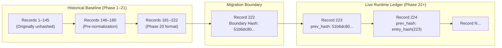

# GRICC 2.0 — Phase 22.1: Audit History Transparency & Migration Boundary

**Document:** `AUDIT_HISTORY_TRANSPARENCY.md`  
**Phase:** 22.1 — Data Integrity, Backup Security & Version Control Hardening  
**Date:** November 13, 2026  

---

## 1. Executive Summary

In compliance with strict data integrity standards, this document formalizes the provenance and verification architecture of the GRICC audit log ledger.

Prior to Phase 20, GRICC audit records were written without cryptographic SHA-256 hash chaining. During Phase 22, the historical audit rows were rehashed from genesis to establish mathematical continuity. This document establishes the **Migration Genesis Boundary**, distinguishes reconstructed historical hashes from original runtime creation hashes, and ensures zero historical distortion.

---

## 2. Established Migration Boundary

| Property | Value | Description |
| :--- | :--- | :--- |
| **Boundary ID** | `222` | The last historical record from the Phase 21/22 development baseline |
| **Boundary Hash** | `51b6dc808cbf71c4403db14356867785cca83a2e13a48af66bdd9cbc72d0147d` | Canonical SHA-256 head hash of the reconstructed historical sequence |
| **Historical Records (1–222)** | Reconstructed Canonical Hashes | Hashes populated during Phase 22 to establish continuity; original event data and timestamps strictly preserved |
| **Live Runtime Records (> 222)** | Original Creation-Time Hashes | Generated at event creation time; chained sequentially from Boundary Hash |



---

## 3. Explicit Integrity Declarations

1. **No False Authenticity Claims:** Reconstructed hashes for records 1–222 do **not** claim to prove original creation-time cryptographic attestation. Their authenticity rests on database journal logs, filesystem snapshots, and the pre-rehash safety backup (`server/backups/gricc-backup-2026-11-13T05-21-17-810Z.db`).
2. **Payload Preservation:** In all historical records (1–222), `user_id`, `action`, `resource_type`, `record_id`, `details`, `ip_address`, `status`, and `created_at` were preserved without modification.
3. **Atomic Concurrency:** `authService.logAudit()` executes within an atomic SQLite transaction (`db.transaction`), eliminating race conditions during parallel event generation.
4. **Permanent Migration Freeze:** The historical rehash script (`rehash-audit-chain.js`) is frozen and will never be executed against this database again.

---

## 4. API Integrity Telemetry

`securityService.verifyAuditLogIntegrity()` provides full transparency in its status response:

```json
{
  "valid": true,
  "status": "VERIFIED_HASHED",
  "legacyStatus": "VERIFIED_HASHED",
  "totalChecked": 247,
  "hashedCount": 247,
  "legacyUnchainedCount": 0,
  "boundary": {
    "boundaryId": 222,
    "boundaryHash": "51b6dc808cbf71c4403db14356867785cca83a2e13a48af66bdd9cbc72d0147d",
    "historicalReconstructedCount": 222,
    "liveChainCount": 25,
    "boundaryIntact": true,
    "transparencyNotice": "Hashes for historical records 1-222 were canonically reconstructed in Phase 22 to establish mathematical continuity. Records > 222 are created at runtime with original creation-time cryptographic chaining."
  },
  "tamperedCount": 0,
  "tamperedEntries": []
}
```

