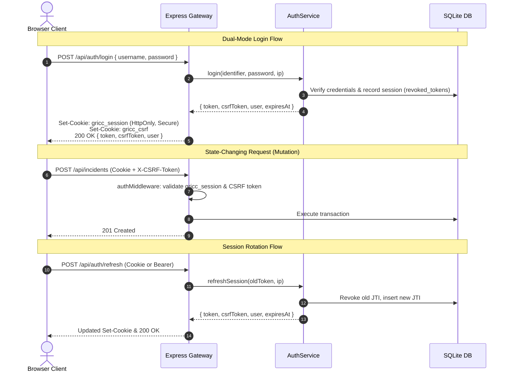

# GRICC 2.0 — Phase 22: Authentication & Session Security Implementation

**Document:** `AUTHENTICATION_SECURITY_IMPLEMENTATION.md`  
**Phase:** 22 — Core System Stabilization, Security Hardening & Mobile Responsive Engineering  
**Risk Addressed:** `SEC-001` (Browser LocalStorage JWT Token Exposure)  
**Date:** November 13, 2026  

---

## 1. Executive Summary

In Phase 21, `SEC-001` identified that user JWT bearer tokens were stored exclusively in browser `localStorage`, making sessions susceptible to token theft in the event of any cross-site scripting (XSS) compromise.

Phase 22 implements an enterprise-grade **Dual-Mode Secure Session Architecture**:
1. **HttpOnly Cookie Authentication:** Web clients authenticate via `HttpOnly`, `SameSite=Strict` (production) / `SameSite=Lax` (development), `Secure` cookies named `gricc_session`.
2. **Double-Submit CSRF Protection:** State-changing requests (`POST`, `PUT`, `PATCH`, `DELETE`) authenticated via cookie require a matching `X-CSRF-Token` header validated against the `gricc_csrf` cookie.
3. **Session Rotation & Safe Renewal:** Implemented `/api/auth/refresh` which revokes previous token identifiers (`jti`) and issues freshly signed session tokens, preventing token replay attacks.
4. **Zero-Breakage Compatibility:** Standard `Authorization: Bearer <token>` headers and SSE streaming query parameters (`?token=<jwt>`) remain fully supported for CLI tools, curl, automated test suites, and EventSource connections.

---

## 2. Architecture & Request Flow

---

## 3. Cookie Configuration Specifications

| Attribute | Development (`NODE_ENV=development`) | Production (`NODE_ENV=production`) | Purpose |
| :--- | :--- | :--- | :--- |
| **Name** | `gricc_session` | `gricc_session` | Cryptographically signed JWT token |
| **HttpOnly** | `true` | `true` | Blocks JavaScript access (`document.cookie`) |
| **Secure** | `false` (permits http://localhost) | `true` (enforces HTTPS) | Prevents cleartext interception |
| **SameSite** | `Lax` | `Strict` | Defends against cross-site request forgery |
| **Path** | `/` | `/` | Scoped to platform root |
| **MaxAge** | 8 hours (28,800,000 ms) | 8 hours (28,800,000 ms) | Aligns with security policy lifetime |

---

## 4. CSRF Defense Implementation

CSRF validation is enforced transparently in `server/middleware/authMiddleware.js`:
- **Read Requests (`GET`, `HEAD`, `OPTIONS`):** Excluded from CSRF validation per RFC-7231 idempotent operations.
- **Bearer Token Authorization:** When clients explicitly provide `Authorization: Bearer <token>`, CSRF verification is bypassed because custom request headers cannot be forged cross-origin without CORS pre-flight consent.
- **Cookie Session Authorization:** When requests arrive with `gricc_session` without an Authorization header, `X-CSRF-Token` is strictly required and compared with `gricc_csrf`. Mismatches trigger HTTP `403 Forbidden` (`CSRF_INVALID`).

---

## 5. Token Revocation & Cleanup

- Tokens are registered in `revoked_tokens (jti, user_id, expires_at, revoked, revoked_at)`.
- `authService.logout(jti, user)` marks `revoked = 1`, records a security audit log, and clears both session cookies.
- Periodic cleanup runs via `securityService.cleanupExpiredTokens()` to purge expired session records without locking active tables.

