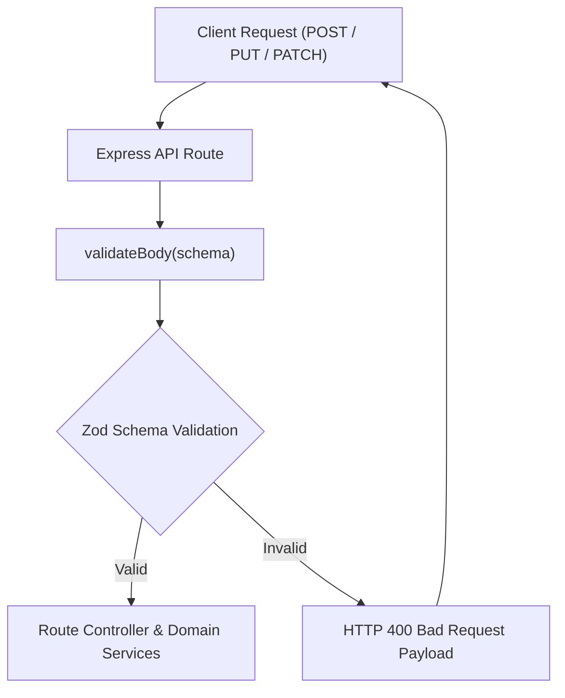

# GRICC 2.0 — Phase 22: Backend Validation Implementation

**Document:** `BACKEND_VALIDATION_IMPLEMENTATION.md`  
**Phase:** 22 — Core System Stabilization, Security Hardening & Mobile Responsive Engineering  
**Risk Addressed:** `BE-001` (Absence of Declarative Schema Validation on API Inputs)  
**Date:** November 13, 2026  

---

## 1. Executive Summary

In Phase 21, the backend audit identified that API routes relied on dispersed, procedural input checks across various services. This led to inconsistent error structures (some endpoints returning HTTP 400 with `{ error: 'ValidationError' }`, others throwing generic errors caught as HTTP 500).

In Phase 22, **Zod** was integrated to provide centralized, declarative request validation with standard error payloads across mutation endpoints.

---

## 2. Validation Architecture



---

## 3. Standardized Error Payload Format

When validation fails, `validateBody` intercepts the request before any database mutations occur and returns:

```json
{
  "error": "ValidationError",
  "code": "INVALID_REQUEST_BODY",
  "message": "Request payload validation failed.",
  "details": [
    {
      "field": "title",
      "message": "Title must be at least 3 characters",
      "code": "too_small"
    },
    {
      "field": "severity",
      "message": "Severity must be Critical, High, Medium, or Low",
      "code": "invalid_enum_value"
    }
  ],
  "timestamp": "2026-11-13T10:55:00.000Z"
}
```

---

## 4. Protected Endpoints & Schemas

| Route | HTTP Method | Schema Name | Validated Fields |
| :--- | :--- | :--- | :--- |
| `/api/auth/login` | `POST` | `loginSchema` | `identifier` (min 1, max 100), `password` (min 1, max 128) |
| `/api/incidents` | `POST` | `createIncidentSchema` | `title` (3-200), `country` (2-100), `severity` (enum), `category`, `description` (5-5000), `lat`, `lng` |
| `/api/incidents/:id` | `PUT` | `updateIncidentSchema` | Partial attributes: `title`, `country`, `severity`, `status`, `description`, `lat`, `lng` |
| `/api/ai/chat` | `POST` | `aiChatSchema` | `message` (1-4000), `conversationId`, `country` |
| `/api/ai/generate-report` | `POST` | `aiGenerateReportSchema` | `title` (3-200), `reportType`, `country`, `countries`, `notes` |
| `/api/collaboration/discussions` | `POST` | `collaborationDiscussionSchema` | `title` (3-200), `description` (3-5000), `priority`, `visibility`, `tags` |
| `/api/collaboration/tasks` | `POST` | `collaborationTaskSchema` | `title` (3-200), `description`, `assignedTo`, `priority`, `dueDate` |

