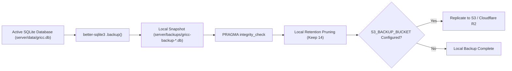

# GRICC 2.0 — Phase 22: Monitoring & Deployment Reliability

**Document:** `MONITORING_AND_DEPLOYMENT_RELIABILITY.md`  
**Phase:** 22 — Core System Stabilization, Security Hardening & Mobile Responsive Engineering  
**Risks Addressed:** `ARCH-001` (Single-Instance Process Constraint) & `DEP-002` (Database Backups & Disaster Recovery)  
**Date:** November 13, 2026  

---

## 1. Executive Summary

Phase 21 identified two operational considerations:
1. **`ARCH-001`:** Single SQLite writer constraints and local in-memory caches require strict single-instance process execution.
2. **`DEP-002`:** Database backups were stored strictly on the local filesystem without off-site cloud replication hooks.

Phase 22 formalizes single-instance PM2 governance, provides detailed health telemetry, and integrates an S3-compatible cloud replication hook for disaster recovery.

---

## 2. Process Management Architecture (PM2 Single-Instance Enforcement)

Because GRICC utilizes SQLite with Write-Ahead Logging (WAL) and memory-backed cache/SSE connection pools, production deployments must run strictly as **one instance in fork mode**:

### `ecosystem.config.cjs`:
```javascript
module.exports = {
  apps: [
    {
      name: 'gricc-api',
      script: 'server/index.js',
      instances: 1,             // CRITICAL: Must be exactly 1 instance
      exec_mode: 'fork',        // CRITICAL: Do NOT use cluster mode with SQLite
      max_memory_restart: '1G',
      autorestart: true,
      env: {
        NODE_ENV: 'production',
        PORT: 5000,
      },
    },
  ],
};
```

---

## 3. Off-Site Cloud Backup Replication (`server/scripts/backup-database.js`)

The database backup utility was extended to support optional automated replication to S3-compatible cloud object storage (AWS S3, Cloudflare R2, MinIO, Wasabi):



### Supported Environment Variables:
- `S3_BACKUP_BUCKET`: Target bucket name.
- `S3_ENDPOINT`: S3-compatible API endpoint (e.g., Cloudflare R2 or MinIO).
- `S3_UPLOAD_URL`: Optional presigned PUT endpoint for zero-credential upload.

---

## 4. Enhanced Health & Diagnostics Endpoints

1. **`/api/health`:** Standard public monitoring probe returning status, database connectivity, provider status counts, and operational mode.
2. **`/api/health/detailed`:** Enhanced diagnostics returning process PID, Node.js version, platform architecture, uptime seconds, and memory consumption (RSS, heap total, heap used, external), with safe suppression of internal server paths.

