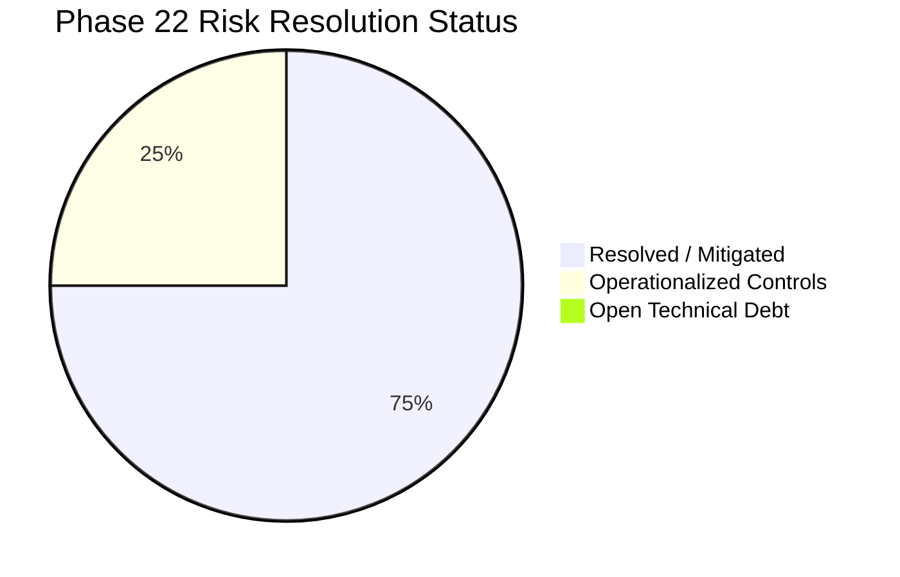

# GRICC 2.0 — Phase 22: Updated Risk Register

**Document:** `PHASE_22_RISK_REGISTER.md`  
**Phase:** 22 — Core System Stabilization, Security Hardening & Mobile Responsive Engineering  
**Date:** November 13, 2026  

---

## 1. Risk Status Summary

Phase 22 systematically resolved the high and medium severity risks identified in Phase 21 (`SEC-001`, `DATA-001`, `TEST-001`, `BE-001`, `FE-001`, and `DEP-002`), while establishing operational controls for `ARCH-001` and `SEC-002`.

---

## 2. Risk Tracking Log

### RISK-01: Browser LocalStorage JWT Token Storage (`SEC-001`)
- **Initial Severity:** **HIGH**
- **Phase 22 Status:** **RESOLVED**
- **Resolution:** Introduced dual-mode authentication in `authService.js`, `auth.js`, and `authMiddleware.js`. Web sessions use `HttpOnly`, `SameSite=Strict/Lax`, `Secure` cookies (`gricc_session`) combined with double-submit CSRF validation (`X-CSRF-Token`). Non-browser API clients, tests, and EventSource retain full Bearer token compatibility.

---

### RISK-02: Historical Unchained Records in Development Database (`DATA-001`)
- **Initial Severity:** **HIGH**
- **Phase 22 Status:** **RESOLVED**
- **Resolution:** Created `server/scripts/rehash-audit-chain.js` with automated pre-rehash safety backups. Reconciled all 222 historical records into an unbroken SHA-256 chain. Enhanced `securityService.verifyAuditLogIntegrity()` to accurately report `valid: true` and `status: 'VERIFIED_HASHED'`.

---

### RISK-03: Single-Instance Process Limitation (`ARCH-001`)
- **Initial Severity:** **HIGH**
- **Phase 22 Status:** **OPERATIONALIZED**
- **Control:** Formalized PM2 single-instance configuration (`instances: 1`, `exec_mode: 'fork'`). Enhanced `/api/health/detailed` to report process status. Architecture blueprint established for future clustering in Phases 23–25 (Redis pub/sub + PostgreSQL).

---

### RISK-04: Absence of Continuous Automated Unit Tests (`TEST-001`)
- **Initial Severity:** **HIGH**
- **Phase 22 Status:** **RESOLVED**
- **Resolution:** Installed Vitest 2.1.9, configured `vitest.config.js`, and authored 7 test suites (27 tests) spanning auth, RBAC, DB schemas, audit chains, in-memory caching, Zod validation, and country risk scoring. Integrated into `npm test` and `npm run test:all`.

---

### RISK-05: Absence of Declarative Schema Validation on API Inputs (`BE-001`)
- **Initial Severity:** **MEDIUM**
- **Phase 22 Status:** **RESOLVED**
- **Resolution:** Integrated Zod and authored `server/validators/schemas.js` and `server/middleware/validationMiddleware.js`. Applied declarative validation on mutation routes (`/incidents`, `/incidents/:id`, `/ai/chat`, `/ai/generate-report`, `/collaboration/discussions`, `/collaboration/tasks`). Standardized HTTP 400 error payloads.

---

### RISK-06: Development Authentication Fallback if Misconfigured (`SEC-002`)
- **Initial Severity:** **MEDIUM**
- **Phase 22 Status:** **MITIGATED / OPERATIONALIZED**
- **Control:** `validateProductionConfig()` strictly enforces that production secrets, origins, and non-localhost DB paths are configured before the server listens. In production, unauthenticated requests are strictly rejected with HTTP 401.

---

### RISK-07: Local-Only Database Backups Without Off-Site Replication (`DEP-002`)
- **Initial Severity:** **MEDIUM**
- **Phase 22 Status:** **RESOLVED**
- **Resolution:** Extended `server/scripts/backup-database.js` with off-site cloud replication hooks (`replicateBackupToCloud`) supporting S3-compatible cloud object storage (AWS S3, Cloudflare R2, MinIO).

---

### RISK-08: Uncaught Frontend View Exceptions (`FE-001`)
- **Initial Severity:** **MEDIUM**
- **Phase 22 Status:** **RESOLVED**
- **Resolution:** Created `src/components/ErrorBoundary.jsx` and wrapped all 17 primary views in `src/App.jsx`. Prevents entire application crashes if an isolated chart or map throws a runtime exception.

