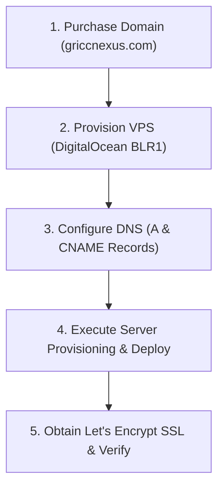

# GRICC 2.0 — Phase 24.1: Remaining Infrastructure Requirements
**Prerequisites & External Provisioning Roadmap for Public Deployment**

**Project:** GRICC Nexus  
**Domain Target:** `griccnexus.com` / `www.griccnexus.com`  
**Infrastructure Target:** DigitalOcean Bengaluru (`BLR1`), Ubuntu 24.04 LTS (x64)  
**Document:** `REMAINING_INFRASTRUCTURE_REQUIREMENTS.md`  
**Date:** November 13, 2026  
**Auditor:** Principal Cloud Architect & Infrastructure Engineer  

---

## 1. Overview of Unresolved External Dependencies

In accordance with strict project safety rules, no credit cards were charged, no domain names were purchased, and no cloud servers were provisioned during Phase 24 and Phase 24.1.

All application code, reverse proxy configurations, process managers, build artifacts, test suites, and database migration scripts are completely prepared offline. To transition GRICC Nexus from local preparation to live public production, the operator must complete the 5 infrastructure acquisition steps detailed below.

---

## 2. Infrastructure Acquisition Checklist



---

### Step 1: Purchase Domain Name (`griccnexus.com`)
- **Target Registrar:** Namecheap, Cloudflare Registrar, Porkbun, or GoDaddy.
- **Primary Domain:** `griccnexus.com`.
- **Alternative / Redirect Alias:** `www.griccnexus.com`.
- **Privacy Protection:** Enable WHOIS Privacy Protection (free on Namecheap/Cloudflare/Porkbun).
- **Cost Estimate:** ~$10.00 – $14.00 USD / year.

---

### Step 2: Provision DigitalOcean Droplet
- **Cloud Provider:** DigitalOcean.
- **Datacenter Region:** Bengaluru (`BLR1`), India.
- **Operating System Image:** Ubuntu 24.04 LTS (Noble Numbat) x64.
- **Recommended Hardware Tier:**
  - Plan: Regular or Premium Intel / AMD Droplet.
  - vCPUs: 2 to 4 vCPUs.
  - Memory: 4 GB to 8 GB RAM (4 GB minimum for Vite compilation; 8 GB recommended for comfortable analytical headroom).
  - Storage: 80 GB to 160 GB NVMe SSD.
- **Cost Estimate:**
  - 2 vCPU / 4 GB RAM / 80 GB SSD: ~$24 USD / month.
  - 4 vCPU / 8 GB RAM / 160 GB SSD: ~$48 USD / month.
- **SSH Key Authentication:**
  - When creating the Droplet, select **SSH Key** (do not use root password authentication).
  - Add the operator's public SSH key (`~/.ssh/id_ed25519.pub` or `~/.ssh/id_rsa.pub`).

---

### Step 3: Configure Public DNS Records
Once the Droplet is provisioned and assigned a public static IPv4 address (`<DROPLET_PUBLIC_IP>`):

| Type | Name / Host | Target / Value | TTL | Purpose |
| :--- | :--- | :--- | :--- | :--- |
| **A** | `@` | `<DROPLET_PUBLIC_IP>` | 300s (5m) | Apex domain `https://griccnexus.com` |
| **CNAME** | `www` | `griccnexus.com.` | 300s (5m) | Subdomain `https://www.griccnexus.com` |

*Wait 5 to 15 minutes for DNS propagation before running Certbot.*

---

### Step 4: Execute Provisioning & Deploy Application
Once the VPS is accessible via SSH:

#### 4.1 Server Provisioning
```bash
ssh root@<DROPLET_PUBLIC_IP>
# Clone or upload deploy/setup-server.sh
chmod +x setup-server.sh
./setup-server.sh
```
*This installs Nginx, Node.js 24, PM2, Certbot, Fail2Ban, configures UFW firewall, creates user `gricc`, imports SSH keys, and configures passwordless Nginx reloads.*

#### 4.2 Application Upload & Initial Launch
```bash
# Upload application code to /var/www/gricc (via git clone or rsync/tar)
# Switch to user gricc
su - gricc
cd /var/www/gricc
cp .env.example .env
# Edit .env with production secrets (JWT_SECRET, BACKUP_ENCRYPTION_KEY, CORS_ORIGIN)
chmod +x deploy/deploy-app.sh
./deploy/deploy-app.sh
```

---

### Step 5: Let's Encrypt TLS Certificate Issuance
To avoid the Nginx bootstrap failure where Nginx cannot start because certificates do not exist yet, follow this Certbot issuance workflow:

#### 5.1 Bootstrap ACME Port 80 Challenge
Verify Nginx is serving the HTTP ACME challenge location from `deploy/nginx.griccnexus.com.conf`:
```bash
sudo certbot certonly --webroot -w /var/www/certbot \
  -d griccnexus.com \
  -d www.griccnexus.com \
  --email admin@griccnexus.com \
  --agree-tos \
  --no-eff-email
```

#### 5.2 Enable Full HTTPS Configuration & Reload Nginx
```bash
sudo cp deploy/nginx.griccnexus.com.conf /etc/nginx/sites-available/griccnexus.com
sudo ln -sf /etc/nginx/sites-available/griccnexus.com /etc/nginx/sites-enabled/
sudo rm -f /etc/nginx/sites-enabled/default
sudo nginx -t
sudo systemctl reload nginx
```

#### 5.3 Verify Automatic TLS Renewal
```bash
sudo certbot renew --dry-run
```
*(Certbot automatically installs a systemd timer at `/lib/systemd/system/certbot.timer` to renew certificates prior to expiration).*

---

### Step 6: Offsite S3 Cloud Backup Configuration (Optional)
To enable offsite backup synchronization:
1. Create an S3 bucket (AWS S3, DigitalOcean Spaces, or Cloudflare R2).
2. Generate a secure presigned PUT URL with 24-hour expiration or configure cron credentials.
3. Populate `BACKUP_S3_PRESIGNED_URL` in `/var/www/gricc/.env`.
4. Automated backups will upload AES-256-GCM encrypted `.db.enc` archives offsite after every local snapshot.

---

## 3. Summary of Status Classifications

| Component | Status | Required Action to Unblock |
| :--- | :--- | :--- |
| Application Source Code & Build | `PASS` | None (Ready) |
| Reverse Proxy (Nginx) Config | `PASS` | None (Ready) |
| PM2 Process Supervision Config | `PASS` | None (Ready) |
| OS Setup & Hardening Script | `PASS` | None (Ready) |
| Database Integrity & Backup Chains | `PASS` | None (Ready) |
| Domain Registration | `BLOCKED BY MISSING INFRASTRUCTURE` | Operator purchase `griccnexus.com` |
| Cloud Droplet | `BLOCKED BY MISSING INFRASTRUCTURE` | Operator create DigitalOcean Droplet |
| DNS Records | `BLOCKED BY MISSING INFRASTRUCTURE` | Configure A / CNAME in registrar |
| SSL / TLS Certificates | `BLOCKED BY MISSING INFRASTRUCTURE` | Issue via Certbot on live droplet |

