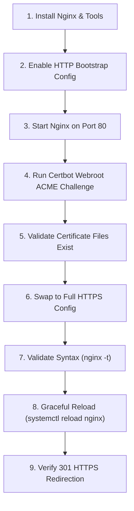

# GRICC 2.0 — Phase 24.3: Nginx & Certbot First-Start Bootstrap Protocol
**Safe Zero-Downtime TLS Provisioning & Rollback Specification**

**Project:** GRICC Nexus  
**Domain Target:** `griccnexus.com` / `www.griccnexus.com`  
**Infrastructure Target:** DigitalOcean Bengaluru (`BLR1`), Ubuntu 24.04 LTS (x64)  
**Document:** `NGINX_CERTBOT_BOOTSTRAP.md`  
**Date:** November 13, 2026  
**Auditor & Implementation Engineer:** Application Security & DevOps Specialist  

---

## 1. Problem Definition: The Nginx SSL Bootstrap Conundrum

When deploying Nginx with Let's Encrypt certificates, a classic circular dependency exists:
1. Nginx must be running on Port 80 to respond to the Certbot HTTP-01 ACME challenge at `/.well-known/acme-challenge/`.
2. However, if the primary Nginx configuration file (`nginx.griccnexus.com.conf`) contains `ssl_certificate /etc/letsencrypt/live/griccnexus.com/fullchain.pem`, Nginx will crash on startup with:
   ```text
   nginx: [emerg] cannot load certificate "/etc/letsencrypt/live/griccnexus.com/fullchain.pem": BIO_new_file() failed (SSL: error:02001002:system library:fopen:No such file or directory)
   ```
3. Attempting to start Nginx fails, which prevents Certbot from validating the ACME challenge, resulting in a broken deployment state.

To resolve this, Phase 24.3 introduces a 9-step bootstrap protocol utilizing `deploy/nginx.bootstrap.conf`.

---

## 2. The 9-Step Safe First-Start Sequence



---

### Step 1: Install Nginx & Dependencies
Executed via `deploy/setup-server.sh`:
```bash
apt-get update && apt-get install -y nginx certbot python3-certbot-nginx
```

### Step 2: Enable HTTP-Only Bootstrap Configuration
Copy `deploy/nginx.bootstrap.conf` to `/etc/nginx/sites-available/griccnexus.com` and enable it:
```bash
sudo cp /var/www/gricc/deploy/nginx.bootstrap.conf /etc/nginx/sites-available/griccnexus.com
sudo ln -sf /etc/nginx/sites-available/griccnexus.com /etc/nginx/sites-enabled/
sudo rm -f /etc/nginx/sites-enabled/default
```

### Step 3: Start Nginx on Port 80
Because `nginx.bootstrap.conf` contains **zero SSL directives**, Nginx starts cleanly:
```bash
sudo nginx -t
sudo systemctl restart nginx
```
Verify port 80 is listening:
```bash
curl -I http://127.0.0.1
# Expected output: HTTP/1.1 200 OK (Content-Type: text/plain)
```

### Step 4: Run Certbot Webroot ACME Challenge
Once public DNS points `griccnexus.com` and `www.griccnexus.com` to the VPS IP, request the certificate:
```bash
sudo certbot certonly --webroot -w /var/www/certbot \
  -d griccnexus.com \
  -d www.griccnexus.com \
  --email security@griccnexus.com \
  --agree-tos \
  --no-eff-email
```

### Step 5: Validate Certificate Files Exist
Confirm that Certbot successfully wrote both the certificate chain and private key:
```bash
sudo test -f /etc/letsencrypt/live/griccnexus.com/fullchain.pem && echo "Certificate: OK"
sudo test -f /etc/letsencrypt/live/griccnexus.com/privkey.pem && echo "Private Key: OK"
```
*(If either test fails, DO NOT proceed to Step 6; consult the rollback steps below).*

### Step 6: Enable Full HTTPS Configuration
Replace the bootstrap configuration with the authoritative production virtual host:
```bash
sudo cp /var/www/gricc/deploy/nginx.griccnexus.com.conf /etc/nginx/sites-available/griccnexus.com
```

### Step 7: Validate Nginx Syntax
Confirm the SSL configuration syntax passes validation:
```bash
sudo nginx -t
# Output must indicate: syntax is ok, test is successful
```

### Step 8: Reload Nginx
Gracefully reload Nginx with zero dropped connections:
```bash
sudo systemctl reload nginx
```

### Step 9: Verify HTTP to HTTPS Redirection
Test that unencrypted requests receive a clean 301 redirect to HTTPS:
```bash
curl -I http://griccnexus.com
# Expected output: HTTP/1.1 301 Moved Permanently -> Location: https://griccnexus.com/
```

---

## 3. Rollback & Troubleshooting Procedures

If certificate issuance fails during Step 4 (e.g., DNS propagation delays or rate limits):

1. **Keep Bootstrap Configuration Active:**
   - Do not install `nginx.griccnexus.com.conf`.
   - Leave `nginx.bootstrap.conf` in `/etc/nginx/sites-available/griccnexus.com`.
   - Nginx continues running on Port 80, serving health checks and allowing repeated ACME retries.
2. **Inspect Certbot Logs:**
   ```bash
   sudo cat /var/log/letsencrypt/letsencrypt.log
   ```
3. **Verify DNS Propagation:**
   ```bash
   dig +short A griccnexus.com
   dig +short CNAME www.griccnexus.com
   ```
   Ensure both point to the Droplet's public IPv4 address.
4. **Retry Certificate Issuance:**
   ```bash
   sudo certbot certonly --webroot -w /var/www/certbot -d griccnexus.com -d www.griccnexus.com --dry-run
   ```
   Once `--dry-run` succeeds, run without `--dry-run` and proceed to Step 5.
