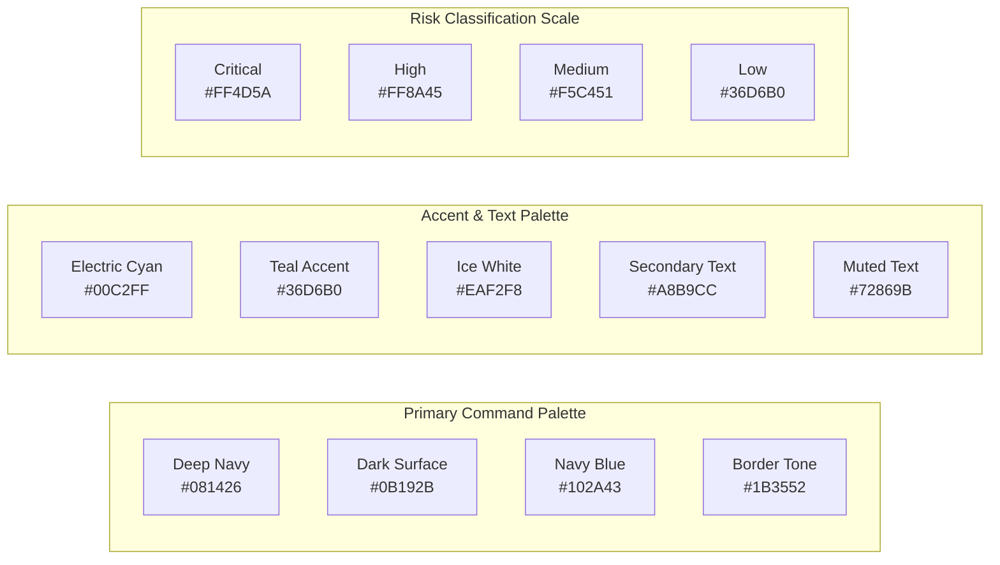

# GRICC Nexus — Phase 24.5: Design System Specification
**Midnight Intelligence Visual Tokens, Typography & Component Styling**

**Project:** GRICC Nexus  
**Document:** `DESIGN_SYSTEM.md`  
**Date:** November 13, 2026  
**Architect:** Senior Full-Stack & UI/UX Specialist  

---

## 1. Color Palette Tokens



### 1.1 CSS Custom Properties (`src/index.css`)
```css
:root {
  /* Midnight Intelligence Design Tokens */
  --color-midnight-base: #081426;
  --color-midnight-blue: #102A43;
  --color-dark-surface: #0B192B;
  --color-electric-cyan: #00C2FF;
  --color-teal-accent: #36D6B0;
  --color-ice-white: #EAF2F8;
  --color-text-secondary: #A8B9CC;
  --color-text-muted: #72869B;

  /* Risk Scale */
  --color-risk-critical: #FF4D5A;
  --color-risk-high: #FF8A45;
  --color-risk-medium: #F5C451;
  --color-risk-low: #36D6B0;
}
```

### 1.2 Tailwind Configuration Mappings (`tailwind.config.js`)
- `midnight-base`: `#081426`
- `midnight-blue`: `#102A43`
- `midnight-surface`: `#0B192B`
- `midnight-border`: `#1B3552`
- `accent-cyan`: `#00C2FF`
- `accent-teal`: `#36D6B0`
- `accent-ice`: `#EAF2F8`
- `accent-secondary`: `#A8B9CC`
- `accent-muted`: `#72869B`
- `risk-critical`: `#FF4D5A`
- `risk-high`: `#FF8A45`
- `risk-medium`: `#F5C451`
- `risk-low`: `#36D6B0`

---

## 2. Typography Guidelines

- **Primary Typeface:** `Inter`, `-apple-system`, `BlinkMacSystemFont`, `Segoe UI`, sans-serif.
- **Monospace Typeface:** System `font-mono` (`ui-monospace`, `SFMono-Regular`, `Menlo`, monospace) for numerical data, coordinates, status indicators, and timestamps.
- **Hierarchy:**
  - Hero Headline: `text-3xl sm:text-4xl lg:text-5xl font-extrabold tracking-tight text-accent-ice`
  - Section Title: `text-xl md:text-2xl font-bold tracking-tight text-accent-ice`
  - Card Title: `text-base font-semibold text-accent-ice`
  - Metric Value: `text-3xl font-extrabold font-mono text-accent-ice`
  - Body Text: `text-sm text-accent-secondary leading-relaxed`
  - Meta/Subtext: `text-xs text-accent-muted font-mono`

---

## 3. UI Components & Micro-Interactions

### 3.1 Command Cards
- **Background:** `bg-midnight-surface` with `border border-midnight-border`.
- **Corner Radius:** `rounded-2xl` (`1rem`).
- **Shadow:** `shadow-lg` / `shadow-2xl`.
- **Hover State:** Border transitions to `rgba(0, 194, 255, 0.4)` with `-translate-y-0.5` lift.

### 3.2 Badges & Status Indicators
- **Critical Risk:** `border-risk-critical/40 bg-risk-critical/15 text-risk-critical`
- **High Risk:** `border-risk-high/40 bg-risk-high/15 text-risk-high`
- **Medium Risk:** `border-risk-medium/40 bg-risk-medium/15 text-risk-medium`
- **Low Risk / Healthy:** `border-risk-low/40 bg-risk-low/15 text-risk-low`
- **Operational / Verified:** `border-accent-cyan/30 bg-accent-cyan/10 text-accent-cyan`

### 3.3 Buttons & Actions
- **Primary Action (Command):** `bg-gradient-to-r from-accent-cyan to-blue-600 text-midnight-base font-bold shadow-[0_0_20px_rgba(0,194,255,0.3)] hover:scale-[1.02]`
- **Secondary Action:** `border border-midnight-border bg-midnight-blue/60 text-accent-ice hover:bg-midnight-hover hover:border-accent-cyan/40`
- **Ghost Action:** `text-accent-secondary hover:text-accent-cyan`

---

## 4. Accessibility & Motion Guidelines

- **Contrast Ratios:** All text on dark surfaces exceeds WCAG AA requirements ($\ge 4.5:1$ for normal text, $\ge 7:1$ for headings).
- **Reduced Motion:** Interactive globe auto-rotation respects `prefers-reduced-motion: reduce` and provides explicit user pause/play controls.
- **Focus Rings:** Form inputs and interactive elements feature accessible focus rings: `focus:ring-1 focus:ring-accent-cyan/50 focus:border-accent-cyan/60`.
