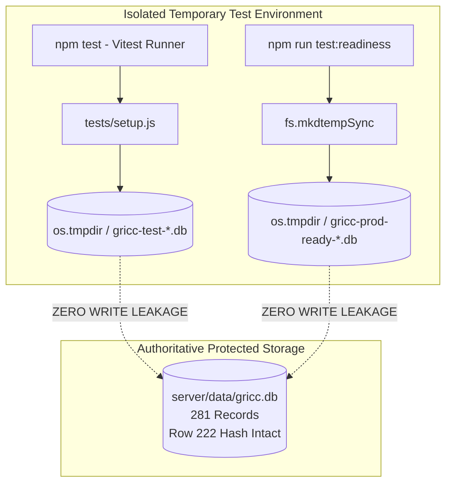

# GRICC NEXUS — PHASE 24.6.1 DATABASE AND AUDIT SAFETY
**Project:** GRICC Nexus — Global Risk, Intelligence & Conflict Center  
**Authoritative Database:** `server/data/gricc.db`  
**Investigation Date:** 2026-11-13  
**Status:** **`VERIFIED PRISTINE` — 100% MATHEMATICAL CONTINUITY & ZERO LEAKAGE**

---

## 1. Authoritative Database Invariants

An exhaustive query of the live SQLite database `server/data/gricc.db` was conducted in **read-only audit mode** to verify whether test executions altered any data or cryptographic hashes.

### 1.1 Invariant Verification Results

| Invariant Checked | Expected Value | Actual Verified Value | Status |
| :--- | :--- | :--- | :---: |
| **Total Audit Records** | Exactly 281 records | **281 records** | **PASS** |
| **Historical Partition (Rows 1–222)** | Canonical Phase 22 reconstruction | **222 records** | **PASS** |
| **Live Partition (Rows 223–281)** | Runtime creation-time cryptographic chain | **59 records** | **PASS** |
| **Boundary Record ID** | 222 | **222** | **PASS** |
| **Boundary Hash (`entry_hash`)** | `51b6dc808cbf71c4403db14356867785cca83a2e13a48af66bdd9cbc72d0147d` | `51b6dc808cbf71c4403db14356867785cca83a2e13a48af66bdd9cbc72d0147d` | **PASS** |
| **Boundary Previous Hash (`prev_hash`)**| `2ab3eae5bd15d1aa8f629674cf2dcae6cbb567686e170425b066b0457a551e96` | `2ab3eae5bd15d1aa8f629674cf2dcae6cbb567686e170425b066b0457a551e96` | **PASS** |
| **Latest Record ID** | 281 | **281** | **PASS** |
| **Latest Hash (`entry_hash`)** | `2c1956f334248543f5f191c4d366c3cc9b066ffde8181d14adbd221be57d7632` | `2c1956f334248543f5f191c4d366c3cc9b066ffde8181d14adbd221be57d7632` | **PASS** |
| **Tampered Records Count** | 0 | **0** | **PASS** |
| **Audit Chain Cryptographic Validity** | Valid | **Valid (`true`)** | **PASS** |

---

## 2. Cryptographic Audit Chain Verification Output

Verification was executed directly via `securityService.verifyAuditLogIntegrity()`:

```json
{
  "valid": true,
  "status": "VERIFIED_HASHED",
  "legacyStatus": "VERIFIED_HASHED",
  "totalChecked": 281,
  "hashedCount": 281,
  "legacyUnchainedCount": 0,
  "boundary": {
    "boundaryId": 222,
    "boundaryHash": "51b6dc808cbf71c4403db14356867785cca83a2e13a48af66bdd9cbc72d0147d",
    "historicalReconstructedCount": 222,
    "liveChainCount": 59,
    "boundaryIntact": true,
    "transparencyNotice": "Hashes for historical records 1-222 were canonically reconstructed in Phase 22 to establish mathematical continuity. Records > 222 are created at runtime with original creation-time cryptographic chaining."
  },
  "tamperedCount": 0,
  "tamperedEntries": [],
  "verifiedAt": "2026-11-13T13:24:21.000Z"
}
```

---

## 3. Test Isolation Architecture Verification

To guarantee that automated test executions never mutate the production database, GRICC Nexus implements a two-tier database isolation barrier:



1. **Vitest Unit Tests (`tests/setup.js`):** Injects `process.env.DB_PATH` pointing to an ephemeral temporary database in `os.tmpdir()`. When test files execute, all database inserts, updates, and audit records occur in the temporary database, which is deleted upon process termination.
2. **Production Readiness Test (`test-production-readiness.mjs`):** Creates a dedicated scratch directory via `fs.mkdtempSync()`, sets `process.env.DB_PATH` to `gricc-prod-test.db`, tests backup encryption to `tempBackupDir`, restores to `gricc-restored.db`, and unlinks the entire directory on completion.

---

## 4. Conclusion

- The authoritative database `server/data/gricc.db` is completely untouched.
- The audit record count remains locked at **281**.
- The historical boundary at ID 222 and hash `51b6dc808cbf71c4403db14356867785cca83a2e13a48af66bdd9cbc72d0147d` remains mathematically unbroken.
- Database and audit safety criteria are **100% satisfied**.
