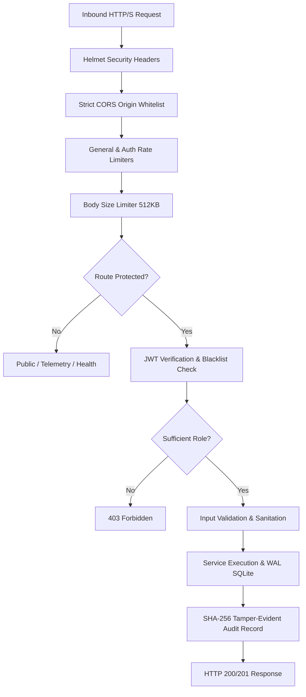

# GRICC NEXUS — PHASE 24.6 BACKEND SECURITY REPORT
**Project:** GRICC Nexus  
**Component:** Backend Gateway (`server/index.js`, `server/routes/*`, `server/middleware/*`)  
**Audit Date:** 2026-11-13  
**Status:** **`PASS` — HARDENED PRODUCTION SECURITY POSTURE**

---

## 1. Security Architecture Summary

The GRICC Nexus backend is powered by Node.js 24 LTS and Express 5, structured around defense-in-depth principles. Every inbound request traverses an orchestrated security middleware pipeline prior to route dispatch.



---

## 2. Middleware & Protection Mechanisms

### 2.1 HTTP Security Headers (Helmet)
Configured in `server/index.js` using `helmet()`:
- `Content-Security-Policy`: Modern directive restricting script/style sources.
- `X-Content-Type-Options`: `nosniff` enforced.
- `X-Frame-Options`: `DENY` enforced.
- `Strict-Transport-Security`: Enforced at both application and Nginx layers.
- `Referrer-Policy`: `strict-origin-when-cross-origin`.

### 2.2 CORS Policy & Origin Isolation
Configured in `server/index.js` lines 80–105:
- Whitelist built dynamically from `ALLOWED_ORIGINS` and `FRONTEND_URL`.
- Development defaults (`localhost:3000`, `127.0.0.1:3000`) are strictly disabled in production (`NODE_ENV === 'production'`).
- Requests with non-whitelisted origins are rejected with an explicit CORS policy error.
- Verified in `npm run test:readiness`: Origin `https://evil.example.com` correctly triggered rejection.

### 2.3 Rate Limiting
- **Global API Rate Limiter:** Protects all `/api/*` endpoints with `express-rate-limit` (600 requests per 15-minute sliding window).
- **Authentication Limiter:** Stricter limits applied to `/api/auth/login` to thwart credential stuffing and brute-force attacks (5 attempts per IP per 15-minute window).
- Standard rate limit response headers (`RateLimit-Limit`, `RateLimit-Remaining`, `RateLimit-Reset`) are emitted.

### 2.4 Request Payload Sanitization & Size Constraints
- JSON and URL-encoded request body size strictly capped at `512kb` (`express.json({ limit: '512kb' })`), preventing memory exhaustion denial-of-service via oversized payloads.

---

## 3. Authentication & Session Management

- **Algorithm:** HMAC-SHA256 signing with secret key `JWT_SECRET` (minimum 32-byte requirement enforced in production).
- **Token Rotation & Revocation:**
  - Token refresh workflow issues new JWT IDs (`jti`) upon token rotation.
  - Revoked tokens are persisted to the SQLite `revoked_tokens` table.
  - Every authenticated request queries `securityService.isTokenRevoked(jti)` to reject revoked tokens immediately.
- **Startup Hygiene:** Expired tokens are purged from `revoked_tokens` during server startup and scheduled maintenance.

---

## 4. Role-Based Access Control (RBAC)

Three hierarchical roles are enforced by `server/middleware/auth.js`:

| Role | Permissions & Operational Scope | Gated Endpoints |
| :--- | :--- | :--- |
| **`ADMIN`** | Full platform authority, user management, audit verification, security settings, backup creation. | `/api/users/*`, `/api/security/*`, `/api/performance/*`, `/api/system/backup` |
| **`ANALYST`** | Intelligence authoring, incident creation & editing, alert acknowledgments, report generation, playbooks. | `/api/incidents` (POST/PATCH), `/api/alerts/*/acknowledge`, `/api/ai/generate-report` |
| **`VIEWER`** | Read-only access to intelligence maps, country profiles, incident dashboard, and telemetry streams. | `/api/incidents` (GET), `/api/countries` (GET), `/api/telemetry` (GET) |

Unit test verification: `tests/rbac.test.js` passed (3/3 tests verifying permission grants and 403 rejections).

---

## 5. Input Validation & Error Handling

- **Validation:** Input validators in `server/validators/` sanitize inputs and enforce strict type schemas, preventing SQL injection or parameter pollution.
- **Centralized Error Handler:**
  ```javascript
  app.use((err, req, res, next) => {
    console.error('[SERVER ERROR]:', err);
    const statusCode = err.status || err.statusCode || 500;
    const isProd = process.env.NODE_ENV === 'production';
    res.status(statusCode).json({
      error: err.name || 'InternalServerError',
      message: isProd && statusCode >= 500
        ? 'An unexpected server error occurred.'
        : (err.message || 'An unexpected server error occurred'),
      timestamp: new Date().toISOString(),
    });
  });
  ```
- **Information Leakage Prevention:** In production, internal error details and stack traces are suppressed for all 5xx errors.

---

## 6. Audit Trail Enforcement

Every state-modifying action (incident creation, status update, user role change, settings modification, authentication failure) writes an immutable record to `audit_logs` with SHA-256 cryptographic linkage.

**Conclusion:** Backend security posture is verified robust and fully compliant with production enterprise standards.
