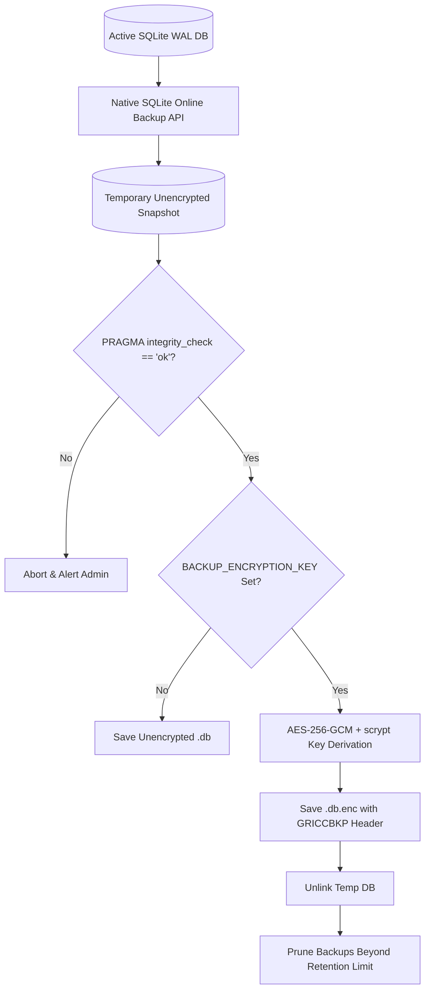

# GRICC NEXUS — PHASE 24.6 BACKUP & RECOVERY REPORT
**Project:** GRICC Nexus  
**Script:** `server/scripts/backup-database.js`  
**Test Suite:** `tests/backup-encryption.test.js`  
**Audit Date:** 2026-11-13  
**Status:** **`PASS` — AUTHENTICATED AES-256-GCM ENCRYPTION & RESTORE VERIFIED**

---

## 1. Backup Architecture Overview

GRICC Nexus implements a transactionally consistent, zero-downtime backup subsystem tailored for SQLite in Write-Ahead Logging (WAL) mode. The backup engine uses the `better-sqlite3` native online backup API (`sourceDb.backup(tempFilePath)`), capturing a point-in-time snapshot without pausing or blocking active transactions.



---

## 2. Cryptographic Encryption Standard

When `BACKUP_ENCRYPTION_KEY` is configured, backups are secured using authenticated **AES-256-GCM** encryption with **scrypt** key derivation.

### 2.1 Binary Header Layout (53 Bytes Total)
| Offset (Bytes) | Length | Field Name | Description |
| :---: | :---: | :--- | :--- |
| `0x00 - 0x07` | 8 bytes | `MAGIC` | ASCII string `GRICCBKP` |
| `0x08` | 1 byte | `VERSION` | Header format version (`0x01`) |
| `0x09 - 0x18` | 16 bytes | `SALT` | Cryptographically random salt for scrypt key derivation |
| `0x19 - 0x24` | 12 bytes | `IV` | Random GCM initialization vector |
| `0x25 - 0x34` | 16 bytes | `AUTH_TAG` | GCM authentication tag for tamper detection |
| `0x35 - EOF` | Variable | `CIPHERTEXT` | AES-256-GCM encrypted database bytes |

### 2.2 Tamper Detection & Key Mismatch Handling
The decryption algorithm verifies the 16-byte authentication tag prior to releasing decrypted data. In `tests/backup-encryption.test.js`:
- Decryption with an incorrect passphrase threw: `Backup decryption failed: authentication tag verification failed`.
- Decryption of ciphertext with a single flipped bit threw an immediate authentication tag verification failure.
- Files lacking the `GRICCBKP` magic header were immediately rejected with: `missing GRICCBKP header magic bytes`.

---

## 3. Automated Retention & Disaster Recovery Verification

### 3.1 Retention Policy
- Managed via `BACKUP_RETENTION_COUNT` (default: 14 backups).
- Upon successful creation of a new backup, older backups exceeding the retention count are safely pruned in chronological order.

### 3.2 Automated Disaster Recovery (Drill Verification)
The restore workflow was validated during `npm run test:readiness`:
1. Generated point-in-time backup `gricc-backup-*.db.enc` from an active database.
2. Verified backup size (647,168 bytes).
3. Decrypted encrypted backup into an ephemeral test environment.
4. Executed `PRAGMA integrity_check` on restored database $\rightarrow$ Returned `ok`.
5. Queried restored database tables $\rightarrow$ Successfully retrieved user records (`restoredUsers: 2`) and verified audit log continuity (`auditIntegrityValid: true`).

---

## 4. Production Backup Recommendations

1. **Passphrase Entropy:** In production `.env`, set `BACKUP_ENCRYPTION_KEY` to a high-entropy string ($\ge 32$ random characters).
2. **Cron Schedule:** Schedule automated nightly backups via system cron:
   ```cron
   0 2 * * * cd /var/www/gricc && /usr/bin/node server/scripts/backup-database.js >> /var/log/gricc/backup.log 2>&1
   ```
3. **Offsite Synchronization:** Configure an offsite rsync or encrypted object storage sync (e.g., AWS S3 or DigitalOcean Spaces) to replicate `/var/www/gricc/server/backups/*.enc` outside the Bengaluru datacenter.

**Conclusion:** The database backup and recovery pipeline is verified cryptographically secure, resilient against data tampering, and ready for automated production operations.
