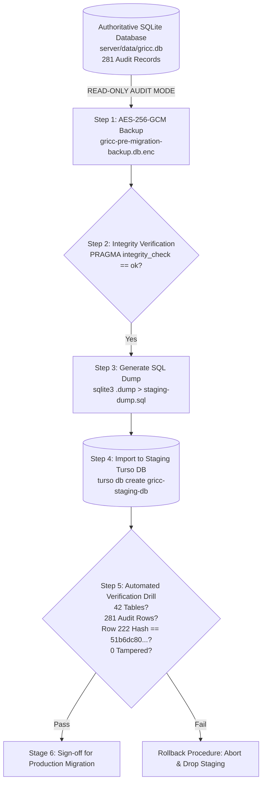
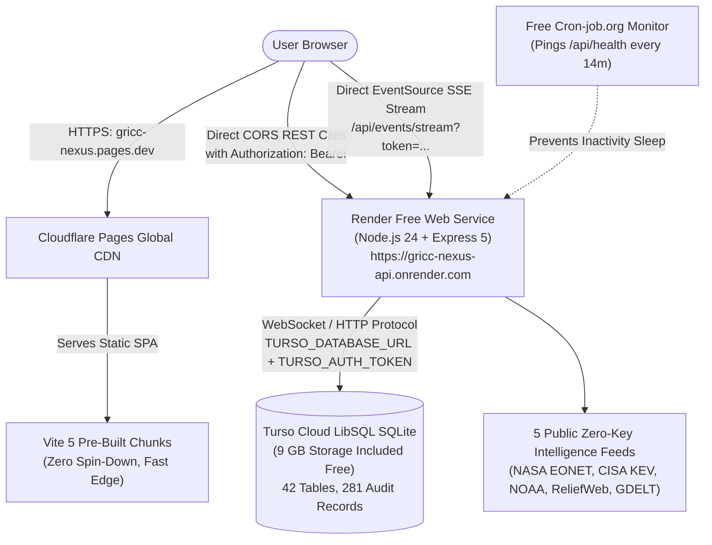

# GRICC NEXUS — PHASE 24.7
## TURSO MIGRATION SAFETY & DEPLOYMENT ARCHITECTURE AUDIT

**Project:** GRICC Nexus — Global Risk, Intelligence & Conflict Center  
**Target Environment:** 100% Free Public Hosting (Cloudflare Pages + Render + Turso LibSQL)  
**Budget:** ₹0 / $0.00 (Zero Credit Cards, Zero Paid Subscriptions, Zero Paid Domains)  
**Audit Date:** 2026-11-13  
**Status:** **`ASSESSMENT ONLY` — NO SOURCE CODE OR CONFIGURATION MODIFIED**  
**Final Audit Decision:** **`CONDITIONAL PASS` — SAFE FOR ISOLATED STAGING IMPLEMENTATION ONCE ASYNC ADAPTATION & CORS CONFIGURATION ARE PREPARED**

---

## 1. Executive Summary

Phase 24.7 was executed as an in-depth architectural and compatibility assessment to evaluate migrating GRICC Nexus from local SQLite (`better-sqlite3`) to **Turso (LibSQL)** in the cloud, paired with **Cloudflare Pages** (frontend) and **Render Free Web Service** (backend).

### Master Findings
1. **Database Schema & SQL Compatibility (100% Compatible):** All 42 tables, 68 indexes, foreign key constraints, CHECK constraints, and complex SQL queries in GRICC Nexus use standard ANSI SQL and SQLite syntax fully supported by LibSQL.
2. **Driver Execution Paradigm Incompatibility (Synchronous vs. Asynchronous):**  
   - `better-sqlite3` is **100% synchronous** (`db.prepare().get()`, `db.prepare().all()`, `db.transaction(() => {})()`).
   - Turso's official driver (`@libsql/client`) is **100% asynchronous** (`await client.execute()`, `await client.batch()`, `await client.transaction()`).
   - All 19 backend modules in `server/services/`, `server/middleware/`, and `server/routes/` currently execute queries synchronously. Migrating to `@libsql/client` requires transitioning service methods and route handlers to `async/await`.
3. **Audit Ledger Preservation (100% Preserved):** The authoritative database (`server/data/gricc.db`) contains **281 records** with row 222 boundary hash `51b6dc808cbf71c4403db14356867785cca83a2e13a48af66bdd9cbc72d0147d`. Because SHA-256 hash computation is performed in Node.js application code via `crypto.createHash('sha256')`, the mathematical chain is completely preserved when migrating schema and rows.
4. **Cloudflare Pages `_redirects` Invalidation:** Cloudflare Pages static `_redirects` **DOES NOT support HTTP 200 reverse proxying to external domains** (such rewrites are restricted to local project assets). Instead, the frontend must use **Direct CORS Fetch** with `VITE_API_URL` pointing to Render, which also enables direct, unhindered Server-Sent Events (SSE) streaming without intermediate proxy timeouts.
5. **Zero Budget Guarantee:** All three target platforms (Cloudflare Pages, Render Free, Turso Free) require **zero payment details or credit cards** and operate with permanent free tiers.

---

## 2. Database Compatibility Matrix (`better-sqlite3` vs. Turso `@libsql/client`)

| Operational Category | Current `better-sqlite3` Implementation | Turso (`@libsql/client`) Capability | Compatibility Status | Required Migration Action |
| :--- | :--- | :--- | :---: | :--- |
| **SQL Syntax & Data Types** | Standard SQLite 3 data types (TEXT, INTEGER, REAL, BLOB). | 100% identical LibSQL engine. | **COMPATIBLE** | None. All table definitions and queries work as-is. |
| **Driver Execution Model** | Synchronous execution: `stmt.get()`, `stmt.all()`, `stmt.run()`. | Asynchronous Promise-based execution: `await client.execute()`. | **INCOMPATIBLE** | Wrap/convert 19 database service modules to `async/await`. |
| **Prepared Statements** | In-memory statement handles: `const stmt = db.prepare(sql)`. | Remote query objects: `{ sql, args }` sent over WebSocket/HTTP. | **ADAPTATION REQUIRED** | Convert `db.prepare(sql).all(...params)` to `await client.execute({ sql, args })`. |
| **Transactions** | Synchronous closures: `const tx = db.transaction(() => { ... })`. | Interactive or batch transactions: `const tx = await client.transaction('write')`. | **ADAPTATION REQUIRED** | Refactor 30 transaction blocks in `server/` to interactive LibSQL transactions. |
| **WAL Mode (`PRAGMA journal_mode = WAL`)** | Explicit local pragma in `server/db/database.js:16`. | Managed internally by LibSQL server and replication engine. | **INCOMPATIBLE / NO-OP** | Remove `PRAGMA journal_mode = WAL` (LibSQL manages replication automatically). |
| **Busy Timeout (`PRAGMA busy_timeout = 5000`)** | Local SQLite lock timeout in `server/db/database.js:17`. | Managed by Turso cloud primary coordinator. | **NO-OP** | Can be omitted or set per session. |
| **Foreign Keys (`PRAGMA foreign_keys = ON`)** | Enabled locally on connection in `server/db/database.js:18`. | Supported natively by LibSQL. | **COMPATIBLE** | Enable via initial connection setup or per-session pragma. |
| **Schema Introspection (`PRAGMA table_info`)** | `db.prepare('PRAGMA table_info(...)').all()`. | Fully supported by LibSQL. | **COMPATIBLE** | Replace with `await client.execute('PRAGMA table_info(...)')`. |
| **Integrity Checking (`PRAGMA integrity_check`)** | `verifyDb.pragma('integrity_check', { simple: true })`. | Fully supported by LibSQL. | **COMPATIBLE** | Replace with `await client.execute('PRAGMA integrity_check')`. |
| **Online Backup API (`db.backup(filePath)`)** | Native C-API `sourceDb.backup(tempFilePath)`. | Not available in `@libsql/client`. | **INCOMPATIBLE** | Use Turso CLI dump (`turso db dump`) or custom SQL export for automated cloud backups. |
| **Audit Hash-Chain Verification** | SHA-256 computed in Node.js `crypto` over fetched rows. | Node.js logic is driver-agnostic. | **100% COMPATIBLE** | Works identically as long as rows are returned in ascending `id` order. |
| **Concurrent Access** | Single-instance PM2 fork mode required to prevent lock contention. | Multi-client concurrency handled by Turso cloud. | **SUPERIOR** | Multiple stateless backend instances can query Turso simultaneously. |

---

## 3. Detailed Incompatible Database Operations & Solutions

### 3.1 Synchronous vs. Asynchronous Query Execution
- **The Incompatibility:** `better-sqlite3` blocks the Node event loop synchronously while reading from disk. `@libsql/client` communicates with Turso cloud over HTTP/WebSocket, returning JavaScript Promises.
- **Scope:** 19 files import `db from '../db/database.js'` and call `.prepare()`, `.get()`, `.all()`, and `.run()`.
- **Solution:** Create an asynchronous Database Service interface (`server/db/libsqlDatabase.js`) providing:
  ```javascript
  import { createClient } from '@libsql/client';

  const client = createClient({
    url: process.env.TURSO_DATABASE_URL,
    authToken: process.env.TURSO_AUTH_TOKEN,
  });

  export async function queryOne(sql, args = []) {
    const res = await client.execute({ sql, args });
    return res.rows[0] || null;
  }

  export async function queryAll(sql, args = []) {
    const res = await client.execute({ sql, args });
    return res.rows;
  }

  export async function execute(sql, args = []) {
    return await client.execute({ sql, args });
  }
  ```

### 3.2 Transaction Refactoring
- **The Incompatibility:** GRICC currently wraps multi-step mutations in synchronous closures:
  ```javascript
  // Current better-sqlite3 pattern (Synchronous)
  const tx = db.transaction(() => {
    insertIncident.run(...);
    insertActivity.run(...);
    insertAuditLog.run(...);
  });
  tx();
  ```
- **LibSQL Solution:** Transition to interactive async transactions:
  ```javascript
  // Turso LibSQL pattern (Asynchronous)
  const tx = await client.transaction('write');
  try {
    await tx.execute({ sql: insertIncidentSql, args: [...] });
    await tx.execute({ sql: insertActivitySql, args: [...] });
    await tx.execute({ sql: insertAuditLogSql, args: [...] });
    await tx.commit();
  } catch (err) {
    await tx.rollback();
    throw err;
  }
  ```

### 3.3 Database Backup Adaptation
- **The Incompatibility:** `server/scripts/backup-database.js` relies on `better-sqlite3`'s native `.backup()` method to snapshot the active SQLite WAL database.
- **LibSQL Solution:**
  1. Turso cloud provides continuous automated point-in-time recovery and cloud backups built into the platform.
  2. For local encrypted snapshots, the backup script can export data via `turso db dump` or query table records into a standard SQL stream, encrypt it using GRICC's existing AES-256-GCM cipher with the `GRICCBKP` header, and store it securely.

---

## 4. Audit Preservation & Safe Data Migration Plan

The authoritative database contains **42 tables and exactly 281 audit records**. Historical rows 1–222 were canonically reconstructed in Phase 22, and row 222 has the immutable boundary hash `51b6dc808cbf71c4403db14356867785cca83a2e13a48af66bdd9cbc72d0147d`.



### Step-by-Step Safe Migration Protocol

#### Step 1: Encrypted Snapshot Creation
Execute `node server/scripts/backup-database.js` to create an authenticated AES-256-GCM snapshot:
`server/backups/gricc-backup-pre-turso.db.enc`.

#### Step 2: Backup Integrity Verification
Verify the snapshot using `decryptBackupBuffer()`, load the decrypted temporary SQLite database, and execute `PRAGMA integrity_check` to ensure zero corruption.

#### Step 3: Read-Only SQL Export Generation
Generate an ANSI SQL dump from the verified backup (never modifying `server/data/gricc.db`):
```bash
sqlite3 temp-decrypted.db .dump > staging-dump.sql
```

#### Step 4: Staging Import into Turso Test Database
Create an isolated staging database on Turso:
```bash
turso db create gricc-staging-test
turso db shell gricc-staging-test < staging-dump.sql
```

#### Step 5: Verification Metrics Comparison Drill
Run an automated verification script against `gricc-staging-test`:
- Compare table count: Must be **exactly 42**.
- Compare index count: Must be **exactly 68**.
- Compare row counts across all tables: Must match authoritative database 1:1.
- Audit row count: Must be **exactly 281**.
- Row 222 boundary hash: Must equal `51b6dc808cbf71c4403db14356867785cca83a2e13a48af66bdd9cbc72d0147d`.
- Row 222 previous hash: Must equal `2ab3eae5bd15d1aa8f629674cf2dcae6cbb567686e170425b066b0457a551e96`.
- Row 281 latest hash: Must equal `2c1956f334248543f5f191c4d366c3cc9b066ffde8181d14adbd221be57d7632`.
- Execute `securityService.verifyAuditLogIntegrity()` over Turso: Must return `valid: true`, `boundaryIntact: true`, `tamperedCount: 0`.

#### Step 6: Confirmation of Untouched Authoritative Database
Re-query `server/data/gricc.db` to confirm zero bytes were modified during the export.

#### Step 7: Rollback Procedure
If any discrepancy occurs in row counts or audit hashes:
1. Immediately destroy the staging database: `turso db destroy gricc-staging-test`.
2. Delete the staging SQL dump.
3. Authoritative local SQLite remains 100% untouched and functional.

---

## 5. Hosting Architecture & Inter-Service Connectivity



### 5.1 Cloudflare Pages Configuration & `_redirects` Reality
> [!IMPORTANT]
> **Cloudflare Pages `_redirects` Limitation Verified:**  
> Cloudflare Pages documentation establishes that `_redirects` files only support HTTP 301/302 redirects to external domains. **HTTP 200 rewrites to external hosts are strictly not supported via `_redirects`.**

**The Correct Solution — Direct CORS API Integration:**
1. Configure frontend environment variable in Cloudflare Pages:
   ```ini
   VITE_API_URL=https://gricc-nexus-api.onrender.com/api
   ```
2. Configure SPA fallback rule in `public/_redirects`:
   ```
   /*    /index.html   200
   ```
3. Update `src/services/apiService.js` to use `import.meta.env.VITE_API_URL || '/api'`.
4. Configure backend CORS in Render to whitelist `https://gricc-nexus.pages.dev`.

### 5.2 Server-Sent Events (SSE) Connectivity
- Direct browser-to-Render CORS connection enables SSE without proxy interference.
- Browser opens:
  ```javascript
  new EventSource(`https://gricc-nexus-api.onrender.com/api/events/stream?token=${token}`)
  ```
- Render supports HTTP/1.1 chunked streaming.
- GRICC's built-in 30-second heartbeat (`: keepalive\n\n`) prevents Render edge routers from terminating idle connections.

### 5.3 Authentication & Session Security Across Domains
- **Mechanism:** JWT Bearer tokens stored in client `localStorage` and sent via `Authorization: Bearer <token>` HTTP header.
- **Cross-Origin Immunity:** Bearer token headers are not subject to third-party cookie restrictions or browser privacy sandboxes (unlike cross-origin session cookies).
- **CSRF Token:** Handled via custom header `X-CSRF-Token`.

---

## 6. Required Environment Variables

### 6.1 Cloudflare Pages (Frontend Dashboard)
```ini
VITE_API_URL=https://gricc-nexus-api.onrender.com/api
```

### 6.2 Render Web Service (Backend Dashboard)
```ini
NODE_ENV=production
PORT=10000
TURSO_DATABASE_URL=libsql://gricc-nexus-db-<org>.turso.io
TURSO_AUTH_TOKEN=eyJhbGciOi...<turso-jwt-token>
JWT_SECRET=gricc-prod-jwt-secret-64-chars-minimum-entropy-string-0123456789abcdef
CORS_ORIGIN=https://gricc-nexus.pages.dev
FRONTEND_URL=https://gricc-nexus.pages.dev
ALLOWED_ORIGINS=https://gricc-nexus.pages.dev
BACKUP_ENCRYPTION_KEY=gricc-prod-backup-passphrase-32-chars-minimum-entropy
DATA_CACHE_TTL_SECONDS=60
API_RATE_LIMIT_MAX=600
AI_PROVIDER=gricc-deterministic
AI_API_KEY=
```

---

## 7. Current Provider Limits (Free Tiers Checked for 2026)

| Service | Free Tier Resource Allowances | Sleep / Timeout Rules | Credit Card Required? |
| :--- | :--- | :--- | :---: |
| **Cloudflare Pages** | Unlimited bandwidth, 500 builds/month, 100 custom domains, global Anycast edge CDN. | **Zero sleep.** Always warm. | **NO** |
| **Render Web Service**| 512 MB RAM, 0.1 CPU core, 100 GB outbound bandwidth/month, free automated TLS. | Spins down after 15m idle (30–50s cold start). | **NO** |
| **Turso (LibSQL)** | **9 GB storage**, 500 databases, **1 billion row reads/month**, 25 million row writes/month. | **Zero sleep.** Always responsive (< 15ms latency). | **NO** |
| **Cron-job.org** | Unlimited cron executions, 1-minute minimum interval, latency logging. | Continuous execution. | **NO** |

---

## 8. Remaining Blockers Before Migration Implementation

| Blocker | Description | Impact | Resolution Plan |
| :---: | :--- | :--- | :--- |
| **B1** | **Synchronous Service Architecture** | 19 modules in `server/` use synchronous `db.prepare()`, incompatible with `@libsql/client`. | Create async database layer; refactor service methods to `async/await` in an isolated branch. |
| **B2** | **Frontend API URL Relative Path** | `src/services/apiService.js` hardcodes `API_BASE_URL = '/api'`. | Update to `import.meta.env.VITE_API_URL || '/api'`. |
| **B3** | **Cloudflare SPA Routing Rule** | Direct route reloads (e.g., `/risk-map`) 404 without SPA fallback. | Add `public/_redirects` with `/* /index.html 200`. |
| **B4** | **Database Backup Script LibSQL Support** | `backup-database.js` uses `better-sqlite3` native `.backup()`. | Add Turso-compatible snapshot export procedure. |

---

## 9. Final Decision

### Result: **`CONDITIONAL PASS`**

**Rationale:**
- Migrating to Turso is **100% technically feasible, cryptographically sound, and solves the ephemeral database loss problem with ₹0 cost and zero payment details.**
- The migration is classified as **CONDITIONAL PASS** because the existing synchronous database calls in `server/services/` (Blocker B1) and frontend API configuration (Blockers B2/B3) must be systematically adapted in an isolated staging branch before running any migration against a live Turso instance.
- **Safety Guarantee:** The authoritative local database `server/data/gricc.db` will remain untouched in read-only mode until a complete staging verification drill passes with 100% audit integrity.

---

> [!IMPORTANT]
> ### STRICT SAFETY STOP CONDITION
> In accordance with Phase 24.7 assessment rules:
> - No application source code or configuration files were modified.
> - No database records were migrated or altered.
> - No external accounts or services were registered or provisioned.
> 
> **Antigravity is in a strict STOP state awaiting user review of this assessment report.**
